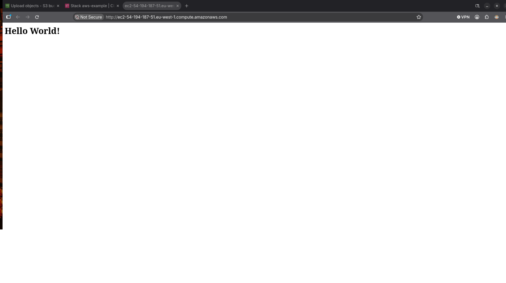
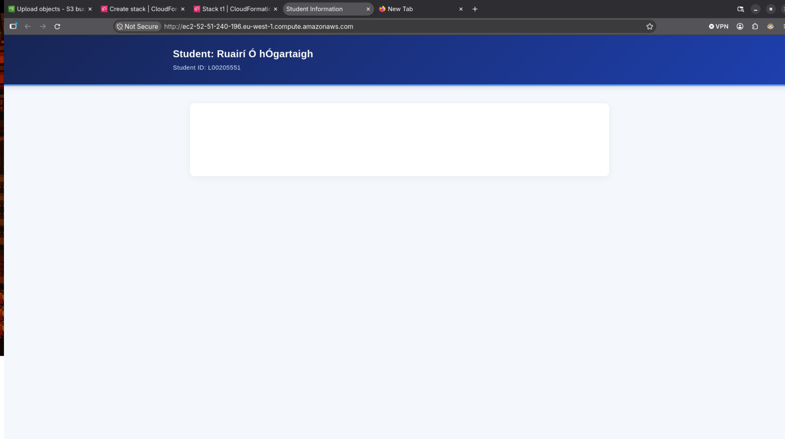

# IaC Assignment 1

**Student:** Ruairí Ó hÓgartaigh  
**Student ID:** L00205551  


---

## Task 1: Printing S3 Data to a Website
**Date:** October 17th, 2026  
### Step 1: CloudFormation Tutorial
To get started on the assignment, the following tutorial and script were read and followed:

* **URL to tutorial:** [AWSCloudFormation/latest/UserGuide/gettingstarted](https://docs.aws.amazon.com/AWSCloudFormation/latest/UserGuide/gettingstarted.walkthrough.html)
* **Date Accessed:** October 17th, 2026

---

### Step 2: Building on the content of the Tutorial Script
This tutorial gave basic insights into running one's first stack on AWS CloudFormation. Upon following the tutorial, it was clear that much of this task's components already existed in this stack. 



The only thing missing was an S3 container storing the webpage text. Instead of running `echo "Hello World!"`, a text document needs to be retrieved from a mounted S3 bucket and its content concatenated (`cat`) to the screen. 

After reviewing and running the stack from this AWS-provided example (which can be found under `./Scripts/Task1/AWS_firstStack.yaml`), the next step was to see how to integrate S3 buckets. The following document was used for reference: [AWS S3 Buckets in YAML](https://docs.aws.amazon.com/AWSCloudFormation/latest/TemplateReference/aws-resource-s3-bucket.html).

---
### Step 3: S3 integration
**Date:** October 18th, 2026 

Today, the S3 bucket will be integrated and a files content concatanated to screen.

As I have no background in web development and the "Hello World" content of the tutorial looks basic on the webpage, I prompted an LLM to generate a html document that will be retrieved from the s3 buckets. Here is the prompt content:

```
I need a simple but cleanly designed html file. The file will just contain two lines of text in the header, the top line reading "Student: John Doe", the second line reading "Student ID: 123456789" , take liberty with remaining asthetic design

```

OpenAI and Gemini were fed this prompt and the files produced can be found in this directory: `./Scripts/Task1/LLM_generated_html_files`.
On viewing the file content in a html renderer the ChatGPT html appeared to be the one that best met the needs for the task. The appropriate changes were made and saved in the main `Scripts` directory under `s3_student_info.html`.


#
The next step is accessing or mounting the s3 bucket so that the ec2 instance can access the file. This [tutorial](https://docs.aws.amazon.com/AWSEC2/latest/UserGuide/AmazonS3.html) on aws was followed.

The S3 bucket was added to `Resources: WebsiteContentBucket` the integration of s3 and ec2 was attempted with the tutorial without success. 


After several attempts including using aws q to help debug, another LLM was prompted to help further debug. After feeding the script into the ChatGPT LLM, it gave feedback recommending using a loop to try pull the html from the s3 bucket. These changes are commented in the provided yaml script.  

These two LLMs recommended addeding read permissions and adding a retry mechanism for the s3 upload to the webpage. On applying these changes, the script worked as desired. 



To further improve the script, in the next entry the script will be further refined to not use a retry mechanism, rather than generated an s3, recall one with the html file already loaded. 

---